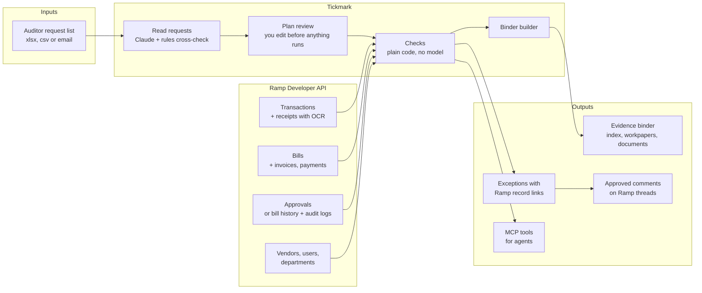
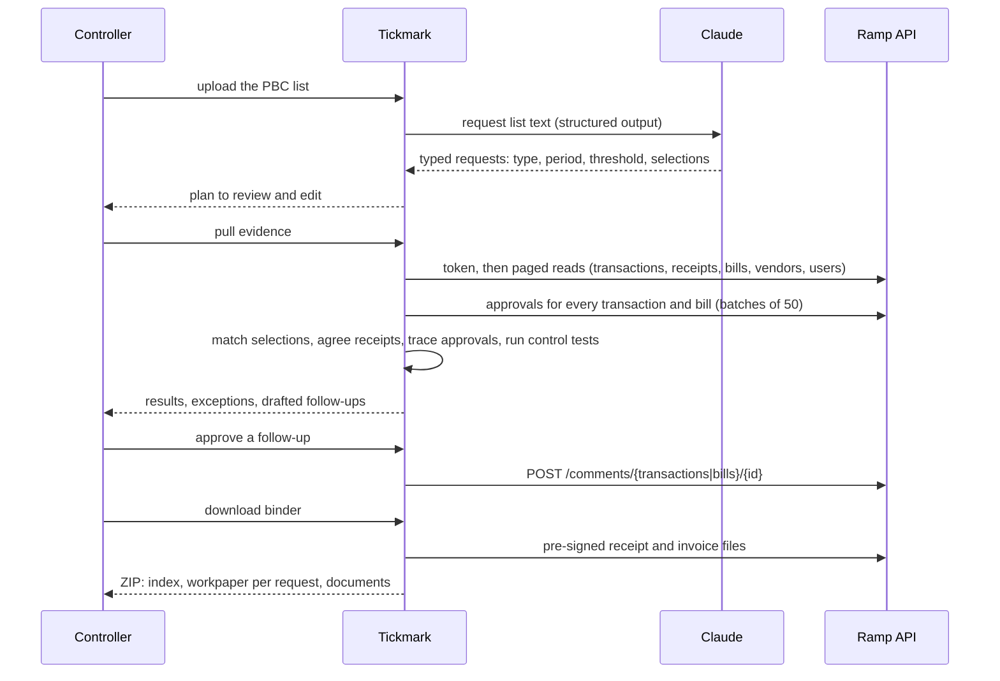

<div align="center">

# Tickmark

**Your auditor's request list, answered from Ramp.** Tickmark reads the year-end **PBC request list**, pulls the
receipts, approvals, bills and payments behind every request **straight from Ramp**, runs the **control tests auditors
run**, and hands back an **evidence binder** where every line traces to a Ramp record. Problems come with a drafted
Ramp comment to the right person, sent only after you approve it.

<br/>


<br/>

</div>

---

**Hackathon:** BBS x Ramp Hackathon (Berkeley Business Society)<br/>
**Challenge:** Pick an outdated financial workflow and rebuild it for 2026 with the newest AI tools<br/>
**Track:** Build it<br/>
**Team:** Volodymyr Borysenko<br/>
**Live demo:** [tickmark-eta.vercel.app](https://tickmark-eta.vercel.app)

| Page | What you'll find |
|------|------------------|
| [Overview](https://tickmark-eta.vercel.app) | The problem, the solution, what it checks |
| [Sample audit](https://tickmark-eta.vercel.app/app?sample=xlsx) | Nine auditor requests, read, tested and turned into a binder |
| [App](https://tickmark-eta.vercel.app/app) | Upload your own request list (Excel, CSV or the auditor's email) |
| [Accuracy](https://tickmark-eta.vercel.app/eval) | Scores on a company with eight planted control problems |
| `/api/mcp` | MCP server, so an agent can run an audit request |

---

## The Problem

Every audit starts the same way. The auditor sends a spreadsheet of requests: **support for these 25 card charges**,
**approval evidence for every bill over $10,000**, **a list of who has admin access**. A controller then spends days
finding receipts, screenshotting approvals, matching payments and filing it all into folders. Ramp's own blog puts it
plainly: preparing for an audit "means gathering receipts, matching transactions, and exporting clean records," and it
["can take days."](https://ramp.com/blog/prepare-data-for-audits-and-compliance-reviews)

The data is already in Ramp. What's missing is the workflow: reading the auditor's list, answering each request with
evidence, and catching the control gaps (a split purchase, a self-approved bill, a bill paid before approval) **before
the auditor does.** Ramp offers exports; Tickmark turns the request list itself into the deliverable.

---

## Built With

| Area | Stack |
|------|-------|
| **App** | Next.js 16 (App Router, Cache Components) · React 19 · TypeScript |
| **Reading requests** | Claude (`claude-opus-5-5`, structured output against a zod schema) · keyword parser as cross-check and fallback |
| **Ramp data** | Ramp Developer API: transactions, receipts (OCR), bills, approvals, vendors, users, audit logs, comments |
| **Auth** | OAuth client credentials (developer app) · user access token · Ramp CLI login |
| **Audit engine** | Deterministic checks · monetary unit sampling · fuzzy selection matching |
| **Binder** | exceljs (index workbook) · pdf-lib (workpapers) · jszip |
| **Agents** | MCP server (`mcp-handler`, Streamable HTTP), read-only tools |
| **Tests** | Vitest · a spec-shaped mock Ramp API · Playwright for end-to-end runs |
| **Hosting** | Vercel |

---

## Architecture at a Glance



### One audit run



---

## How It Works

1. **Read the list.** Excel (including a separate Selections sheet), CSV or a pasted email. Claude turns each request
   into one of seven types with its period, dollar threshold and the items the auditor selected. A keyword parser runs
   on the same input as a cross-check, and takes over if the model call fails. Requests Ramp can't answer (bank recs,
   fixed assets) are marked for the team.
2. **Review the plan.** Nothing runs until the controller checks it and starts the run. Any type can be changed.
3. **Gather.** One snapshot of the period from Ramp, paged and cached for five minutes. Receipts are read 90 days past
   the period end, since they often arrive after the charge.
4. **Test.** Every pass or fail is code over Ramp records:

| Request type | What Tickmark does |
|---|---|
| Transaction support | Matches each auditor selection to a Ramp transaction (exact amount, date within 5 days of transaction or posting date, description tokens), then agrees it to the receipt OCR total (within $1 or 1%), traces the approval and checks the memo. Without selections it draws a monetary unit sample. |
| Bill support | Every bill over the threshold: invoice attached, approver is not the bill owner, approved before payment, payment traced. |
| Missing receipts | Card charges at or above the receipt threshold with nothing attached. |
| Control testing | Split purchases (same cardholder and merchant within 48 hours, each under the approval limit, together over it), self-approval, approval after payment, restricted merchant categories. |
| Duplicate payments | Same vendor and invoice number, or same vendor and amount within 7 days. Archived bills are skipped. |
| Vendor listing | Vendor master; flags new vendors paid within 14 days of setup. |
| User access | Owners, admins, bookkeepers, IT admins and auditors, with status. |

5. **Hand over.** Each exception links to its Ramp records and carries a drafted comment for the cardholder or bill
   owner. Approve it and it posts to that Ramp thread. The binder holds `00 Index.xlsx` (requests, exceptions, evidence
   rows with Ramp ids), a PDF workpaper per request with tickmarks, and every receipt and invoice.

---

## Results

### Accuracy on a company with planted problems

`/eval` runs the sample request list end to end on Acme Robotics, a generated company whose records use Ramp's exact
API field names: 720 card transactions, 638 receipts, 75 bills, 16 vendors, 35 users. Everything is clean except eight
planted problems.

| Planted problem | Check | Found |
|---|---|---|
| Two Digi-Key charges 17 minutes apart, $9,585.50 together, each under the $5,000 limit | Split purchase | ✅ |
| $1,240.00 client dinner, no receipt | Missing receipt | ✅ |
| Receipt says $389.00, card charged $839.00 | Receipt mismatch | ✅ |
| Bill owner approved their own $12,750.00 bill | Self-approval | ✅ |
| $22,300.00 bill paid Jun 2, approved Jun 9 | Approval after payment | ✅ |
| Apex invoice INV-20417 paid twice | Duplicate invoice | ✅ |
| Vendor created Nov 3, paid $18,400.00 two days later | Fast-paid new vendor | ✅ |
| $612.40 at a liquor store, no business purpose | Restricted merchant | ✅ |

**8 of 8 found, 0 false alarms.** The checks run in about 10 ms for all nine requests.

### Against the Ramp API

`tests/live-api.test.ts` runs the live client against a mock Ramp API built to the published spec (client credentials
token, `page.next` pagination, repeated `entity_ids`, scope errors, `get-bill-history`, audit log events, comments,
pre-signed files). It checks that:

- A developer app reads every page and produces **exactly the same findings** as the sample run.
- A **Ramp CLI token without `approvals:read`** rebuilds approvals from bill history and audit logs and still finds all
  eight problems.
- The binder contains the **downloaded** receipt and invoice files.
- Approved comments post to the right thread with a write-scoped token. Rate limits (429) are retried.

**Caveats.** The planted company is generated, so a perfect score shows the checks work as designed, not accuracy on
real books. The mock follows Ramp's published spec; the client has not yet run against a real Ramp sandbox account.

---

## Connecting Ramp

Tickmark uses real Ramp data whenever credentials are present, and falls back to the sample company only when none are.

| Method | Where it works | Set |
|---|---|---|
| **Developer app** (client credentials) | Local and Vercel | `RAMP_CLIENT_ID`, `RAMP_CLIENT_SECRET` |
| **Access token** | Local and Vercel | `RAMP_ACCESS_TOKEN` |
| **Ramp CLI login** | Local | run `ramp auth login`; Tickmark reads `~/.config/ramp/config.toml` |

`RAMP_ENV=production` switches from the sandbox (`demo-api.ramp.com`) to `api.ramp.com`. Check a connection with
`npm run ramp:check`.

**Scopes read:** `transactions:read receipts:read bills:read users:read departments:read vendors:read approvals:read
business:read audit_logs:read`. **Writes:** only approved comments, with `transactions:write` or `bills:write`.

**Getting a sandbox.** The Ramp CLI can start a sandbox application (`ramp --env sandbox applications create`), which
emails a sign-up link for demo.ramp.com. From the sandbox dashboard, create a developer app with the client credentials
grant and copy its id and secret into `.env.local` (and Vercel). When connected, the sample request list is fitted to
your business: the last 12 months, with 12 selections drawn from your own transactions by monetary unit sampling.

---

## Agent API: MCP

`/api/mcp` is a Streamable HTTP MCP server with three read-only tools.

| Tool | Returns |
|------|---------|
| `read_request_list` | Typed requests from a request list (type, period, threshold, selections) |
| `answer_audit_requests` | Each request's result, every exception with its Ramp records, and a drafted follow-up |
| `get_ramp_record` | The transaction, bill, vendor or user behind an exception, with receipts and approvals |

```bash
claude mcp add --transport http tickmark https://tickmark-eta.vercel.app/api/mcp
```

Nothing is posted to Ramp through MCP. Drafts come back to the agent, and sending stays in the app behind a person's
approval.

---

## Run It

```bash
npm install
npm run dev              # http://localhost:3000
npm test                 # engine, parser, sampling, binder, MCP and live API contract tests
npm run ramp:check       # which Ramp connection will be used and what it can read
```

Settings in `.env.local`:

```bash
# Ramp (any one of these)
RAMP_CLIENT_ID=...
RAMP_CLIENT_SECRET=...
# RAMP_ACCESS_TOKEN=...
# RAMP_ENV=production           # default: sandbox

# Claude request reader. Without it, the keyword parser reads requests.
ANTHROPIC_API_KEY=...

# Policy values in dollars (defaults 5000 and 75)
# TICKMARK_CARD_APPROVAL_LIMIT=5000
# TICKMARK_RECEIPT_THRESHOLD=75

# TICKMARK_SOURCE=sample        # force the sample company
```

Run the whole app against the mock Ramp API:

```bash
npm run mock:ramp        # prints the mock URL
RAMP_API_BASE_URL=<url> RAMP_CLIENT_ID=ramp_id_test RAMP_CLIENT_SECRET=ramp_sec_test npm run dev
```

Record the demo video (Chrome, visible cursor, chapter timestamps):

```bash
npm run build && npx next start -p 3790
node scripts/record-demo.mjs http://localhost:3790 demo-out
```

---

## Code Map

| Path | What |
|------|------|
| `src/app/page.tsx` | Landing page: intro, problem, solution |
| `src/app/workbench.tsx` | The app: upload, plan, run, results, drafts, record drawer |
| `src/app/eval/` | Accuracy page |
| `src/app/api/` | `parse`, `run`, `binder`, `comment`, `record`, `eval`, `mcp` routes |
| `src/lib/parse/` | Input reading (xlsx, csv, email), Claude parser, keyword parser, request schema |
| `src/lib/engine/run.ts` | Request handlers and every check |
| `src/lib/engine/sampling.ts` | Monetary unit sampling |
| `src/lib/engine/live-sample.ts` | Fits the sample list to a connected Ramp business |
| `src/lib/ramp/api-client.ts` | Ramp API client: auth modes, paging, retries, approvals fallback |
| `src/lib/ramp/source.ts` | Picks Ramp or the sample company; snapshot cache; record lookup |
| `src/lib/binder/build.ts` | Index workbook, PDF workpapers, evidence files |
| `src/lib/fixtures/generate.ts` | The sample company and its eight planted problems |
| `tests/mock-ramp.ts` | Spec-shaped mock Ramp API |
| `scripts/` | Sample files, Ramp check, mock server, demo recorder |

---

## Limits

- The client is tested against a spec-shaped mock, not yet a real Ramp account. `npm run ramp:check` is the first thing
  to run once credentials exist.
- Policy values (approval limit, receipt threshold) come from environment variables, and restricted merchant codes are
  fixed in code. A real deployment should read them from the company's Ramp spend policy.
- Receipt checks compare the OCR total Ramp stores with the charge. Receipt images are not re-read.
- Amounts are shown in USD.
- Approved comments on the sample company go to an in-memory outbox, not to Ramp.
